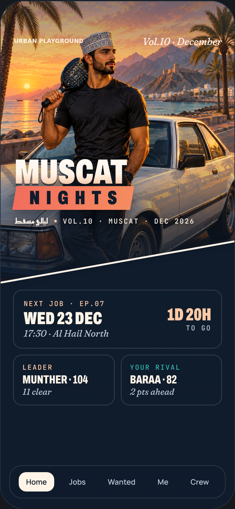

# Home

**Reference:** `screenshots/01-home.png` · **Route:** `/` · **Build phase:** 2

**Purpose:** First screen between sessions: what's next, who leads, who you're chasing.

## Layout (top to bottom)
1. Top bar: UP logo (left), `Vol.10 · December` in serif italic (right), over the hero.
2. Hero, 470px tall: the current session's painting cut with `--mn-cut-hero`, a sand keyline along the cut edge, dark fade at top and bottom.
3. Title lockup bottom-left of hero (see components.md › TitleLockup, size S, no 'presents' line).
4. Glass card: `NEXT JOB · EP.07` label, date `WED 23 DEC` (display 28px), `17:30 · Al Hail North` (serif), countdown `1D 20H` + `TO GO` right-aligned in peach.
5. Two glass cards side by side: LEADER (`MUNTHER · 104`, `11 clear`) and YOUR RIVAL in teal (`BARAA · 82`, `2 pts ahead`).
6. Floating pill nav (components.md › BottomNav), Home active.

## Data
- season.sessions → next session (state soon, lowest no)
- players → rank 1 and its lead over rank 2
- rivals → current user's rival and gap

## States
- Session day before 17:30: countdown shows hours and minutes
- Session live: replace the next-job card with a LIVE card linking to the session (coral border)
- Current user is #1: rival card shows `#2 chasing · N pts` instead

## Interactions
- Next-job card → session detail
- Leader card → Most Wanted
- Rival card → Your Rival moment screen

## Acceptance checklist
Tick every box in your phase report. Anything unticked must be listed with the reason.
- [ ] Hero image is the next session's `art`
- [ ] Countdown updates every minute
- [ ] Live state swaps in on session nights
- [ ] Matches the reference screenshot at 375px wide (layout, order, sizes, colours)
- [ ] All colours, fonts, radii come from tokens.css (no hard-coded hex values)
- [ ] No text smaller than 11px; no horizontal overflow at 360px
- [ ] All data comes from the data layer / fixtures, not hard-coded
- [ ] Every tappable element is a real <button> or <a> with a min 44px target
