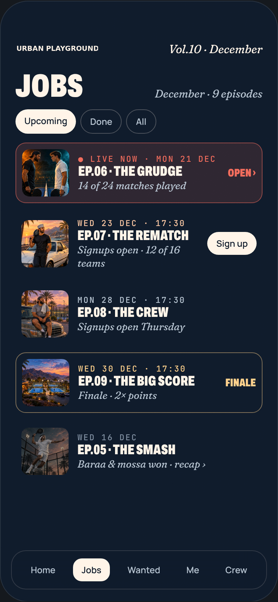

# Jobs (sessions list)

**Reference:** `screenshots/02-jobs.png` · **Route:** `/jobs` · **Build phase:** 2

**Purpose:** All nine sessions as episodes.

## Layout (top to bottom)
1. Header `JOBS` (display 44px) with `December · 9 episodes` (serif) right.
2. Filter pills: Upcoming (default) · Done · All.
3. Rows: 64px rounded thumbnail of the session art, label (date or `● Live now · date`), title `EP.0N · TITLE` (display 19px), sub-line (serif), optional right element.
4. Live row: coral tint background + coral border, right text `OPEN ›`.
5. Next row with open signups: `Sign up` sand pill on the right, sub-line `Signups open · 12 of 16 teams`.
6. Finale row: gold border, right text `FINALE`, sub-line `Finale · 2× points`.
7. Done rows: thumbnail greyed (grayscale .6, brightness .7), sub-line `<champions> won · recap ›`.

## Data
- season.sessions (all fields)

## States
- Filter Upcoming/Done/All
- No upcoming sessions: show `Season complete` with link to The Take

## Interactions
- Row → session detail (live/soon) or recap (done)
- Sign up pill → existing signup flow

## Acceptance checklist
Tick every box in your phase report. Anything unticked must be listed with the reason.
- [ ] Exactly 9 sessions with EP codes
- [ ] Finale row styled gold
- [ ] Done rows show champions
- [ ] Matches the reference screenshot at 375px wide (layout, order, sizes, colours)
- [ ] All colours, fonts, radii come from tokens.css (no hard-coded hex values)
- [ ] No text smaller than 11px; no horizontal overflow at 360px
- [ ] All data comes from the data layer / fixtures, not hard-coded
- [ ] Every tappable element is a real <button> or <a> with a min 44px target
