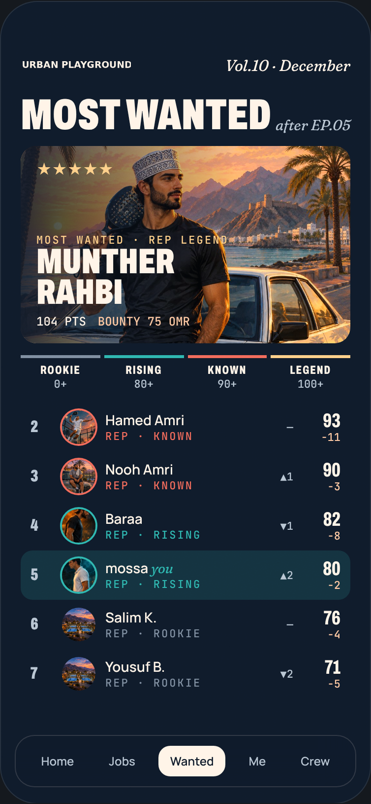

# Most Wanted (table)

**Reference:** `screenshots/03-most-wanted.png` · **Route:** `/wanted` · **Build phase:** 2

**Purpose:** The series table.

## Layout (top to bottom)
1. Header `MOST WANTED` + `after EP.05` (latest finished session).
2. Leader card 200px: leader's art, dark left-to-right fade, five gold stars top-left, label `Most wanted · Rep Legend`, name in 2 lines (display 36px), `104 PTS` and `BOUNTY 75 OMR` (peach).
3. Rep legend: 4 columns ROOKIE 0+, RISING 80+, KNOWN 90+, LEGEND 100+, each with a 3px top bar in its colour.
4. Rows from #2 down: rank, 34px round avatar (ring in rep colour when Rising or above), name, `REP · <LEVEL>` in rep colour, movement (▲/▼/—), points, and the GAP to the player above under the points in peach (`−11`).
5. Current user row: teal tint background + italic `you` after the name.

## Data
- players sorted by rank
- rep from tokens.repFor(points)
- gap = points of rank-1 minus own points
- bounty = seasonPrizesOMR for ranks 1–3 (if it ended now)

## States
- Ties: same gap 0, shown as `level`
- Fewer than 2 players: hide rows

## Interactions
- Leader card or any row → Crew Card for that player

## Acceptance checklist
Tick every box in your phase report. Anything unticked must be listed with the reason.
- [ ] Gap shown on every row from #2 down and is correct
- [ ] Rep colour matches thresholds in tokens.ts
- [ ] Current user highlighted
- [ ] Matches the reference screenshot at 375px wide (layout, order, sizes, colours)
- [ ] All colours, fonts, radii come from tokens.css (no hard-coded hex values)
- [ ] No text smaller than 11px; no horizontal overflow at 360px
- [ ] All data comes from the data layer / fixtures, not hard-coded
- [ ] Every tappable element is a real <button> or <a> with a min 44px target
