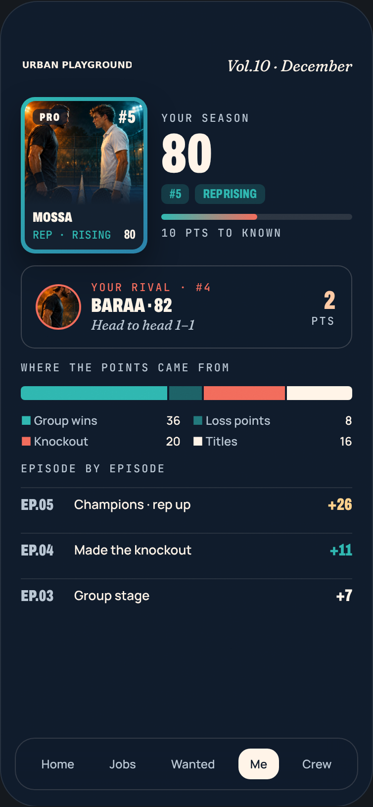

# ME

**Reference:** `screenshots/04-me.png` · **Route:** `/me` · **Build phase:** 2

**Purpose:** The current user's season.

## Layout (top to bottom)
1. Top: small crew card (120px, no foil) left; right column: `YOUR SEASON` label, points (display 56px), chips `#5` and `REP RISING` (teal), progress bar to next rep level (teal→coral gradient), `10 pts to Known`.
2. Glass rival card: 42px avatar with coral ring, `Your rival · #4`, `BARAA · 82`, `Head to head 1–1`, gap number right.
3. `Where the points came from`: stacked bar 14px (group wins teal, loss points teal 45%, knockout coral, titles sand) + 2-column legend with values. Segments must sum exactly to series points.
4. `Episode by episode`: rows `EP.05 · Champions · rep up · +26` etc. Newest first. Points colour gold for titles, teal otherwise.

## Data
- players[currentUserId]
- existing engine per-night receipts (see base handoff)
- rivals

## States
- User is Legend: replace progress with `Top rep reached`
- User has no points yet: empty state `Play your first night`

## Interactions
- Card → Crew Card
- Rival card → Your Rival
- Episode row → existing points receipt

## Acceptance checklist
Tick every box in your phase report. Anything unticked must be listed with the reason.
- [ ] Stacked bar segments sum to series points
- [ ] Progress bar fraction = (points − current level min) / (next level min − current level min)
- [ ] Matches the reference screenshot at 375px wide (layout, order, sizes, colours)
- [ ] All colours, fonts, radii come from tokens.css (no hard-coded hex values)
- [ ] No text smaller than 11px; no horizontal overflow at 360px
- [ ] All data comes from the data layer / fixtures, not hard-coded
- [ ] Every tappable element is a real <button> or <a> with a min 44px target
