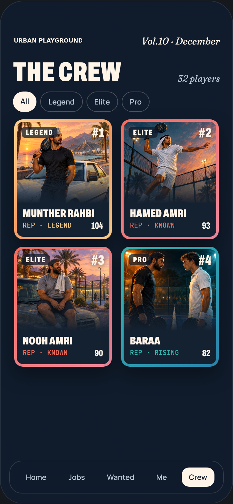

# The Crew (players)

**Reference:** `screenshots/05-crew.png` · **Route:** `/crew` · **Build phase:** 2

**Purpose:** Everyone's crew card.

## Layout (top to bottom)
1. Header `THE CREW` + `32 players`.
2. Filter pills: All · Legend · Elite · Pro (and Street, scrollable).
3. 2-column grid of crew cards (150px wide each; components.md › CrewCard, size M).

## Data
- players sorted by rank
- tier from tokens.tierFor(rank)

## States
- Filter by tier
- Player without art: show initials on navy inside the frame

## Interactions
- Card → Crew Card

## Acceptance checklist
Tick every box in your phase report. Anything unticked must be listed with the reason.
- [ ] Frame gradient matches tier
- [ ] Foil shine only on Legend and Elite
- [ ] Matches the reference screenshot at 375px wide (layout, order, sizes, colours)
- [ ] All colours, fonts, radii come from tokens.css (no hard-coded hex values)
- [ ] No text smaller than 11px; no horizontal overflow at 360px
- [ ] All data comes from the data layer / fixtures, not hard-coded
- [ ] Every tappable element is a real <button> or <a> with a min 44px target
