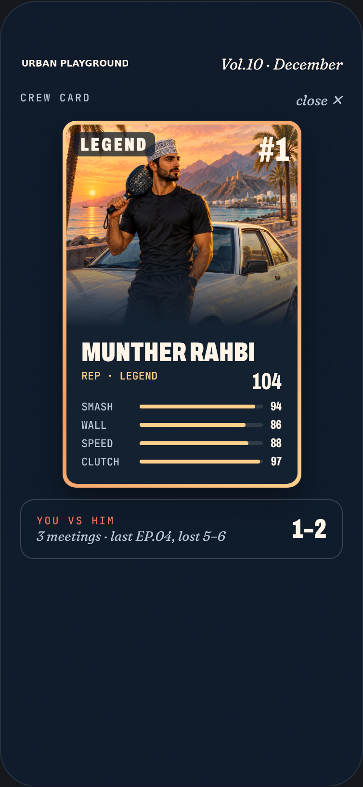

# Crew Card (player detail)

**Reference:** `screenshots/06-crew-card.png` · **Route:** `/crew/:id` · **Build phase:** 2

**Purpose:** One player's card in full.

## Layout (top to bottom)
1. `CREW CARD` label + `close ✕`.
2. Crew card size L (240px) centred, with 4 stat bars (SMASH, WALL, SPEED, CLUTCH) in the rep colour.
3. Legend card only: slow 3D tilt loop and foil sweep (components.md › motion).
4. Glass card: `You vs him` (coral), `3 meetings · last EP.04, lost 5–6`, record `1–2` right. Hidden on your own card.

## Data
- players[id] incl. stats (see data.md › card stats)
- head-to-head vs current user

## States
- Stat with <3 matches behind it shows `—`

## Interactions
- Close → back
- Share (optional) → share sheet MY CARD

## Acceptance checklist
Tick every box in your phase report. Anything unticked must be listed with the reason.
- [ ] Tilt/foil disabled under prefers-reduced-motion
- [ ] Head-to-head hidden on own card
- [ ] Matches the reference screenshot at 375px wide (layout, order, sizes, colours)
- [ ] All colours, fonts, radii come from tokens.css (no hard-coded hex values)
- [ ] No text smaller than 11px; no horizontal overflow at 360px
- [ ] All data comes from the data layer / fixtures, not hard-coded
- [ ] Every tappable element is a real <button> or <a> with a min 44px target
