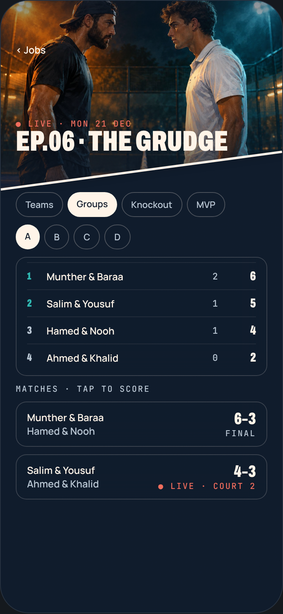

# Session detail · Groups

**Reference:** `screenshots/07-session-groups.png` · **Route:** `/jobs/:no` · **Build phase:** 3

**Purpose:** A live or upcoming session.

## Layout (top to bottom)
1. Header image 250px: session art with the angled cut + keyline; `‹ Jobs` top-left; bottom-left `● Live · Mon 21 Dec` (coral) and `EP.06 · THE GRUDGE` (display 38px).
2. Tabs (pills): Teams · Groups (active) · Knockout · MVP.
3. Group pills A–D.
4. Glass standings card: #, team, W, PTS; top 2 rank numbers in teal (qualify).
5. `Matches · tap to score` + match glass cards (teams left, score right, state label: Final grey / `● Live · Court 2` coral).

## Data
- session-night.json groupA
- existing session engine

## States
- Teams / Knockout / MVP tabs reuse the existing app logic, restyled with glass cards and pills

## Interactions
- Match → Live Scoring (admin) or read-only score

## Acceptance checklist
Tick every box in your phase report. Anything unticked must be listed with the reason.
- [ ] Top 2 marked as qualifying
- [ ] All four tabs restyled, not just Groups
- [ ] Matches the reference screenshot at 375px wide (layout, order, sizes, colours)
- [ ] All colours, fonts, radii come from tokens.css (no hard-coded hex values)
- [ ] No text smaller than 11px; no horizontal overflow at 360px
- [ ] All data comes from the data layer / fixtures, not hard-coded
- [ ] Every tappable element is a real <button> or <a> with a min 44px target
