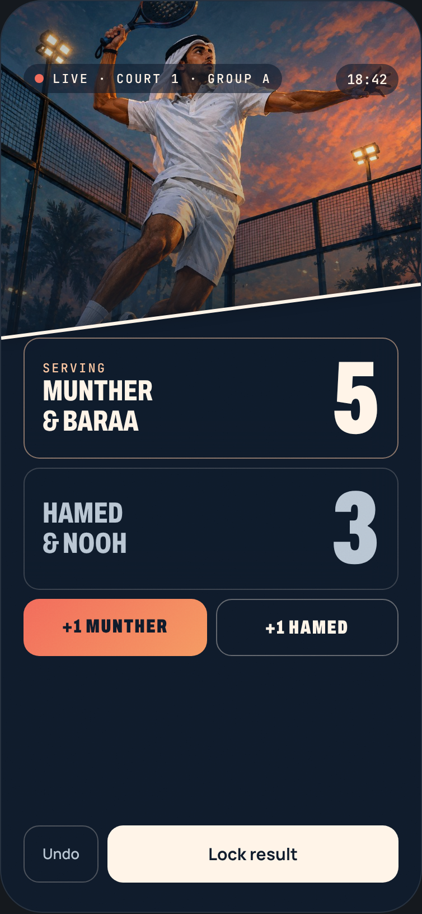

# Live Scoring

**Reference:** `screenshots/08-live-scoring.png` · **Route:** `/jobs/:no/match/:id` · **Build phase:** 3

**Purpose:** Court-side scorer (admin).

## Layout (top to bottom)
1. Header image 300px: action art, angled cut + keyline; top pills `● Live · Court 1 · Group A` and clock `18:42` on glass.
2. Two glass score cards: serving team (peach border, `SERVING` label) and other team (muted text); score 92px display.
3. Buttons: `+1 MUNTHER` (primary gradient) and `+1 HAMED` (ghost), min 56px tall.
4. Bottom: `Undo` ghost + `Lock result` sand button.

## Data
- session-night.json live
- existing scoring engine

## States
- Locked result triggers moments (rep up, score settled) where relevant

## Interactions
- +1, Undo, Lock result as in the existing app

## Acceptance checklist
Tick every box in your phase report. Anything unticked must be listed with the reason.
- [ ] Buttons ≥56px tall
- [ ] Uses existing scoring logic unchanged
- [ ] Matches the reference screenshot at 375px wide (layout, order, sizes, colours)
- [ ] All colours, fonts, radii come from tokens.css (no hard-coded hex values)
- [ ] No text smaller than 11px; no horizontal overflow at 360px
- [ ] All data comes from the data layer / fixtures, not hard-coded
- [ ] Every tappable element is a real <button> or <a> with a min 44px target
