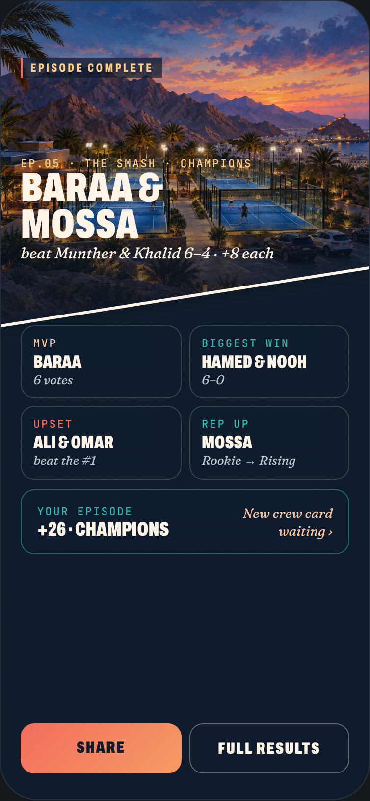

# Episode Recap

**Reference:** `screenshots/09-episode-recap.png` · **Route:** `/jobs/:no/recap` · **Build phase:** 3

**Purpose:** After a session finishes.

## Layout (top to bottom)
1. Header image 330px: club art with cut + keyline, tag `EPISODE COMPLETE` (components.md › SceneTag, gold), label `EP.05 · The Smash · Champions` (gold), champions names (display 42px), `beat Munther & Khalid 6–4 · +8 each` (serif).
2. 2×2 glass tiles: MVP, Biggest win, Upset, Rep up (Rep up tile replaces Biggest climber when someone changed rep that night).
3. Your episode glass card (teal border): `+26 · CHAMPIONS` and `New crew card waiting ›`.
4. Buttons: SHARE (primary) → Recap Slides; FULL RESULTS (ghost).

## Data
- session-night.json recap5

## States
- No rep-ups that night: show Biggest climber

## Interactions
- New crew card → Card Pull moment
- Share → Recap Slides

## Acceptance checklist
Tick every box in your phase report. Anything unticked must be listed with the reason.
- [ ] Rep-up tile appears only when a rep-up happened
- [ ] Matches the reference screenshot at 375px wide (layout, order, sizes, colours)
- [ ] All colours, fonts, radii come from tokens.css (no hard-coded hex values)
- [ ] No text smaller than 11px; no horizontal overflow at 360px
- [ ] All data comes from the data layer / fixtures, not hard-coded
- [ ] Every tappable element is a real <button> or <a> with a min 44px target
