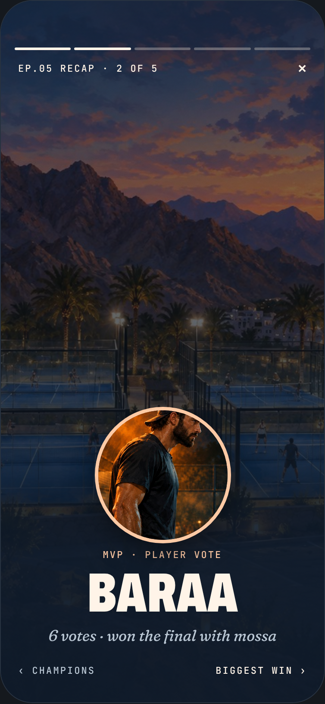

# Recap Slides (new)

**Reference:** `screenshots/10-recap-slides.png` · **Route:** `/jobs/:no/recap/slides` · **Build phase:** 3

**Purpose:** Full-screen story-style recap players can screenshot or share.

## Layout (top to bottom)
1. Background: session art darkened, dark gradient top and bottom.
2. Top: 5 progress segments (filled = sand), `EP.05 recap · 2 of 5`, close ✕.
3. Slides in order: 1 Champions · 2 MVP · 3 Biggest win · 4 Upset · 5 Your night.
4. Slide layout: 150px round photo with peach ring, label (e.g. `MVP · player vote`), big name (display 64px), serif sub-line.
5. Bottom hints: `‹ previous` and `next ›` slide titles.

## Data
- recap data (same as Episode Recap)

## States
- Auto-advance every 5s; pause while pressed
- Last slide: Share button

## Interactions
- Tap right third → next, left third → previous, swipe down or ✕ → close
- Keyboard: ←/→

## Acceptance checklist
Tick every box in your phase report. Anything unticked must be listed with the reason.
- [ ] All 5 slides implemented
- [ ] Tap zones and auto-advance work
- [ ] Respects reduced motion (no auto-advance animation)
- [ ] Matches the reference screenshot at 375px wide (layout, order, sizes, colours)
- [ ] All colours, fonts, radii come from tokens.css (no hard-coded hex values)
- [ ] No text smaller than 11px; no horizontal overflow at 360px
- [ ] All data comes from the data layer / fixtures, not hard-coded
- [ ] Every tappable element is a real <button> or <a> with a min 44px target
