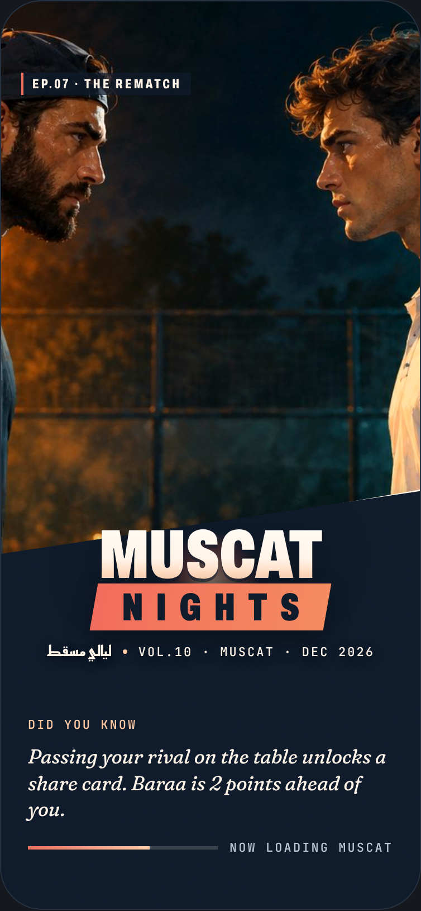

# Now Loading Muscat (loading screen)

**Reference:** `screenshots/11-now-loading-muscat.png` · **Route:** `(app start)` · **Build phase:** 4

**Purpose:** Shown while the app loads, and on first open each session day (once per device per session).

## Layout (top to bottom)
1. Top 58%: the next session's art, cut + keyline; scene tag `EP.07 · THE REMATCH` top-left.
2. Title lockup (size M, no 'presents') centred below the cut.
3. `DID YOU KNOW` label + a personal tip in serif (rotate from a list; personalise with rival or rep data where possible).
4. Progress bar (coral→peach) + label `NOW LOADING MUSCAT`.

## Data
- next session
- tips list (data.md › tips)
- current user's rival/rep for personal tips

## States
- Real loading: bar follows load progress; minimum 1.2s, skippable after data is ready

## Interactions
- Tap anywhere after load → Home

## Acceptance checklist
Tick every box in your phase report. Anything unticked must be listed with the reason.
- [ ] Label reads exactly `NOW LOADING MUSCAT`
- [ ] Shown at most once per device per session day after first load
- [ ] Matches the reference screenshot at 375px wide (layout, order, sizes, colours)
- [ ] All colours, fonts, radii come from tokens.css (no hard-coded hex values)
- [ ] No text smaller than 11px; no horizontal overflow at 360px
- [ ] All data comes from the data layer / fixtures, not hard-coded
- [ ] Every tappable element is a real <button> or <a> with a min 44px target
