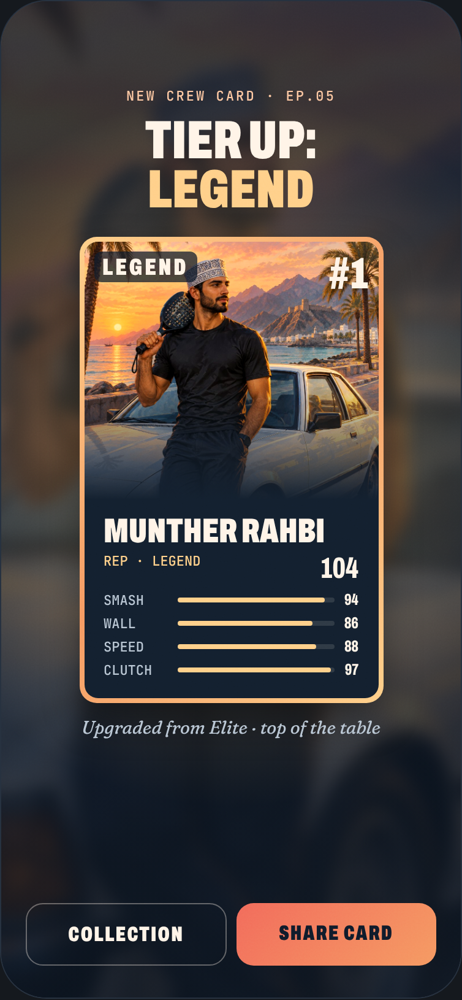

# New Crew Card (card pull)

**Reference:** `screenshots/12-new-crew-card.png` · **Route:** `(moment)` · **Build phase:** 4

**Purpose:** After each finished session, the player's updated card.

## Layout (top to bottom)
1. Background: the card's art blurred and darkened + gold radial glow.
2. Label `New crew card · EP.05`; headline `TIER UP:` / `LEGEND` in gold (or `HOLDING ELITE` / `TIER DOWN: PRO`).
3. Crew card size L with stats, tilt + foil if Legend.
4. Serif line `Upgraded from Elite · top of the table`.
5. Buttons: COLLECTION (ghost → The Crew), SHARE CARD (primary → share sheet).

## Data
- players, previous tier per player (store last seen tier per device)

## States
- Tier up / holding / tier down copy variants

## Interactions
- Shown once per player per finished session, after the recap

## Acceptance checklist
Tick every box in your phase report. Anything unticked must be listed with the reason.
- [ ] Copy variant matches tier change
- [ ] Shown once only
- [ ] Matches the reference screenshot at 375px wide (layout, order, sizes, colours)
- [ ] All colours, fonts, radii come from tokens.css (no hard-coded hex values)
- [ ] No text smaller than 11px; no horizontal overflow at 360px
- [ ] All data comes from the data layer / fixtures, not hard-coded
- [ ] Every tappable element is a real <button> or <a> with a min 44px target
