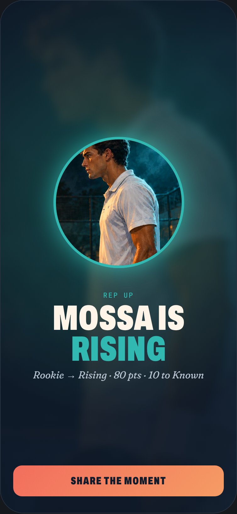

# Rep Up

**Reference:** `screenshots/13-rep-up.png` · **Route:** `(moment)` · **Build phase:** 4

**Purpose:** When a locked result moves a player into a higher rep level.

## Layout (top to bottom)
1. Background: the player's art blurred + teal radial glow (colour = new rep colour).
2. 200px round photo with ring and glow; two expanding rings animate behind it.
3. Label `Rep up`; headline `MOSSA IS` / `RISING` (rep colour), slam-in animation.
4. Serif line `Rookie → Rising · 80 pts · 10 to Known`.
5. Button SHARE THE MOMENT.

## Data
- moments.repUp

## States
- Legend reached: line ends `Top rep reached`

## Interactions
- Show to that player on next open (or immediately if viewing)

## Acceptance checklist
Tick every box in your phase report. Anything unticked must be listed with the reason.
- [ ] Rep never goes down
- [ ] Animations off under reduced motion
- [ ] Matches the reference screenshot at 375px wide (layout, order, sizes, colours)
- [ ] All colours, fonts, radii come from tokens.css (no hard-coded hex values)
- [ ] No text smaller than 11px; no horizontal overflow at 360px
- [ ] All data comes from the data layer / fixtures, not hard-coded
- [ ] Every tappable element is a real <button> or <a> with a min 44px target
