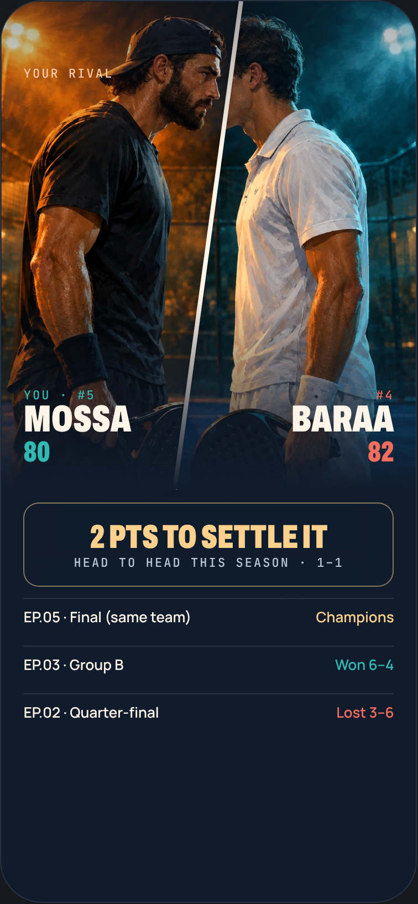

# Your Rival

**Reference:** `screenshots/14-your-rival.png` · **Route:** `/rival` · **Build phase:** 4

**Purpose:** The player directly above you.

## Layout (top to bottom)
1. Top 440px: split screen with a diagonal sand keyline; you on the left, rival on the right (each their own art), dark fade at bottom.
2. Bottom-left: `You · #5` (teal), name, points; bottom-right: `#4` (coral), name, points.
3. Glass card gold border: `2 PTS TO SETTLE IT` (gold display 30px) + `Head to head this season · 1–1`.
4. Last meetings list (3 rows): label left, result right (gold / teal / coral).

## Data
- rivals

## States
- User is #1: show `#2 chasing` variant with #2 on the right

## Interactions
- Rival side → Crew Card

## Acceptance checklist
Tick every box in your phase report. Anything unticked must be listed with the reason.
- [ ] Gap and head-to-head computed from data
- [ ] Matches the reference screenshot at 375px wide (layout, order, sizes, colours)
- [ ] All colours, fonts, radii come from tokens.css (no hard-coded hex values)
- [ ] No text smaller than 11px; no horizontal overflow at 360px
- [ ] All data comes from the data layer / fixtures, not hard-coded
- [ ] Every tappable element is a real <button> or <a> with a min 44px target
