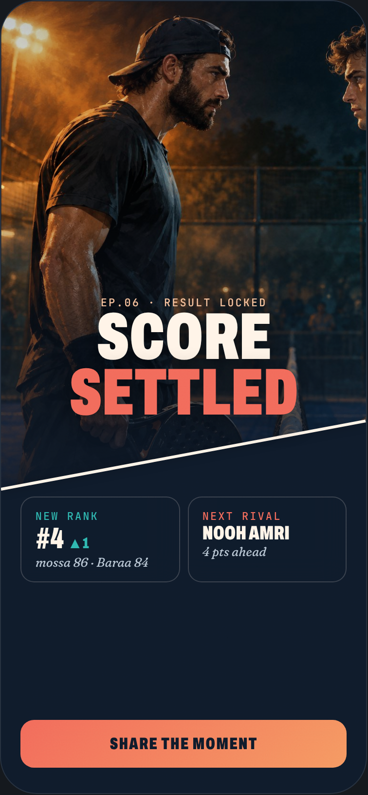

# Score Settled

**Reference:** `screenshots/15-score-settled.png` · **Route:** `(moment)` · **Build phase:** 4

**Purpose:** When a locked result moves you above your rival.

## Layout (top to bottom)
1. Top 500px: rival scene, angled cut + keyline; label `EP.06 · result locked`; headline `SCORE` / `SETTLED` (coral) centred, slam-in.
2. Two glass tiles: NEW RANK `#4 ▲1` + `mossa 86 · Baraa 84`; NEXT RIVAL `NOOH AMRI` + `4 pts ahead`.
3. Button SHARE THE MOMENT.

## Data
- moments.scoreSettled

## Interactions
- Fires on result lock when rank passes rival; then rival updates

## Acceptance checklist
Tick every box in your phase report. Anything unticked must be listed with the reason.
- [ ] Next rival correctly recomputed
- [ ] Matches the reference screenshot at 375px wide (layout, order, sizes, colours)
- [ ] All colours, fonts, radii come from tokens.css (no hard-coded hex values)
- [ ] No text smaller than 11px; no horizontal overflow at 360px
- [ ] All data comes from the data layer / fixtures, not hard-coded
- [ ] Every tappable element is a real <button> or <a> with a min 44px target
