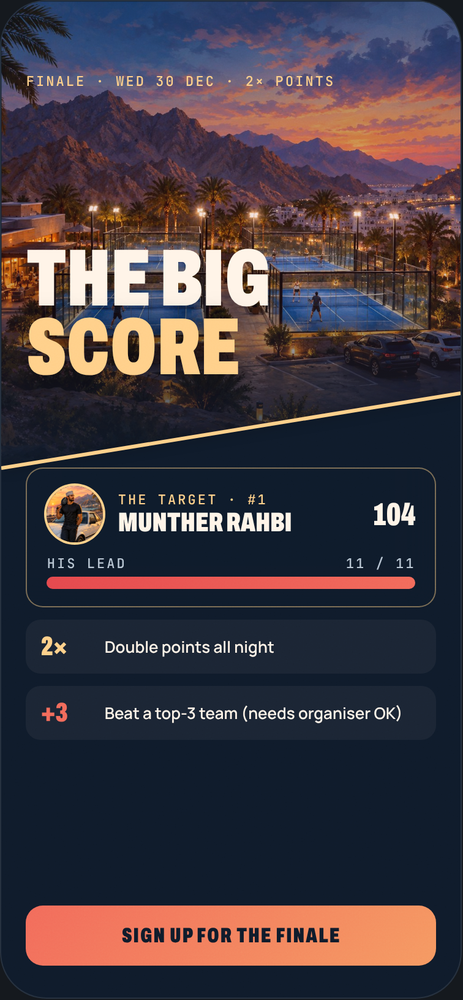

# The Big Score (finale)

**Reference:** `screenshots/16-the-big-score.png` · **Route:** `/finale` · **Build phase:** 4

**Purpose:** Finale takeover for session 9.

## Layout (top to bottom)
1. Top 380px: club art with gold keyline on the cut; label `Finale · Wed 30 Dec · 2× points` (gold); headline `THE BIG` / `SCORE` (gold).
2. Glass card: leader avatar (gold ring), `The target · #1`, name, points; `His lead` bar (red→coral), `11 / 11` (lead now / lead at start of night).
3. Rule rows: `2×  Double points all night`; `+3  Beat a top-3 team (needs organiser OK)`.
4. Button SIGN UP FOR THE FINALE (becomes LIVE · OPEN on the night).

## Data
- season finale config
- players ranks 1–3

## States
- Before / during / after finale
- Hide the +3 row while SEASON.bossKillBonus.enabled is false

## Interactions
- Button → signup or live session

## Acceptance checklist
Tick every box in your phase report. Anything unticked must be listed with the reason.
- [ ] Do NOT implement the +3 bonus in scoring unless enabled in config
- [ ] Matches the reference screenshot at 375px wide (layout, order, sizes, colours)
- [ ] All colours, fonts, radii come from tokens.css (no hard-coded hex values)
- [ ] No text smaller than 11px; no horizontal overflow at 360px
- [ ] All data comes from the data layer / fixtures, not hard-coded
- [ ] Every tappable element is a real <button> or <a> with a min 44px target
