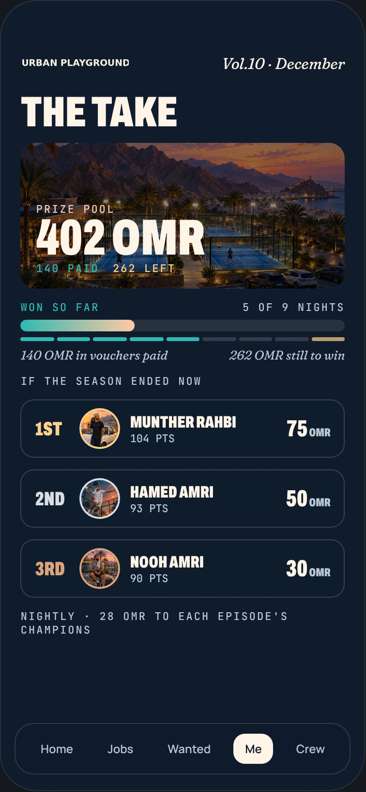

# The Take (prizes)

**Reference:** `screenshots/17-the-take.png` · **Route:** `/take` · **Build phase:** 2

**Purpose:** Prize pool and standings for prizes.

## Layout (top to bottom)
1. Header `THE TAKE`.
2. Hero 150px: club art darkened, `Prize pool` label, `402 OMR` (display 52px), `140 paid` (teal) / `262 left` (gold).
3. NEW meter: label `Won so far` + `5 of 9 nights`; 12px bar (teal→peach) at paid/pool; below it 9 small segments (done teal, finale gold, rest faint); serif line `140 OMR in vouchers paid · 262 OMR still to win`.
4. `If the season ended now`: three glass rows 1ST/2ND/3RD (gold/silver/bronze), avatar, name, points, prize OMR.
5. Label `Nightly · 28 OMR to each episode's champions`.

## Data
- season.prizePoolOMR, paidOMR, sessions
- players ranks 1–3

## Interactions
- Prize row → Crew Card

## Acceptance checklist
Tick every box in your phase report. Anything unticked must be listed with the reason.
- [ ] Meter fraction = paidOMR / prizePoolOMR
- [ ] Segment count = number of sessions
- [ ] Matches the reference screenshot at 375px wide (layout, order, sizes, colours)
- [ ] All colours, fonts, radii come from tokens.css (no hard-coded hex values)
- [ ] No text smaller than 11px; no horizontal overflow at 360px
- [ ] All data comes from the data layer / fixtures, not hard-coded
- [ ] Every tappable element is a real <button> or <a> with a min 44px target
