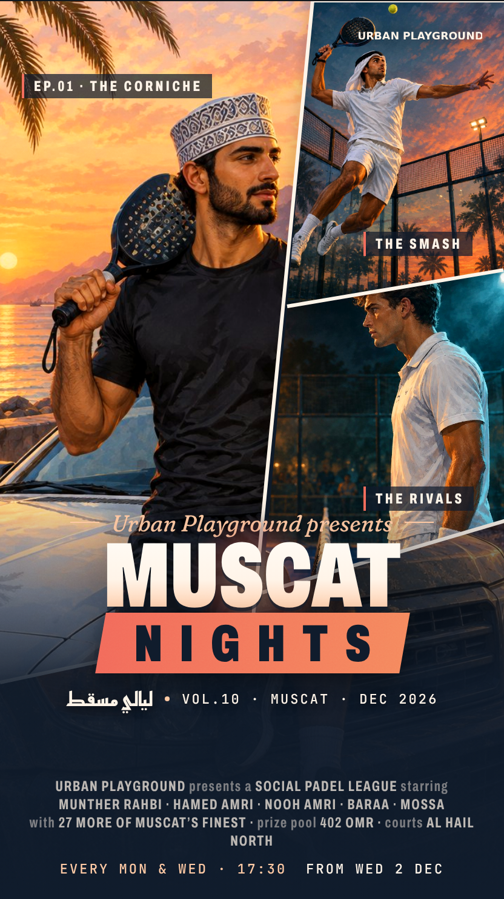

# Story · Campaign Poster

**Reference:** `screenshots/18-story-campaign-poster.png` · **Route:** `(share export)` · **Build phase:** 5

**Purpose:** Launch Instagram story, 1080×1920 export.

## Layout (top to bottom)
1. Shattered panels: hero scene left, two action shards right (smash top, rivals middle), crew scene faded below; sand keylines along every cut; scene tags `EP.01 · THE CORNICHE`, `THE SMASH`, `THE RIVALS`.
2. Title lockup size L with `Urban Playground presents`.
3. Billing block (components.md › Billing) + `Every Mon & Wed · 17:30` / `From Wed 2 Dec`.
4. UP logo top-right.

## Data
- season, top 5 names

## Interactions
- Export at 1080×1920 (render at 416×740 ×2.6)

## Acceptance checklist
Tick every box in your phase report. Anything unticked must be listed with the reason.
- [ ] Exported PNG is 1080×1920
- [ ] Matches the reference screenshot at 375px wide (layout, order, sizes, colours)
- [ ] All colours, fonts, radii come from tokens.css (no hard-coded hex values)
- [ ] No text smaller than 11px; no horizontal overflow at 360px
- [ ] All data comes from the data layer / fixtures, not hard-coded
- [ ] Every tappable element is a real <button> or <a> with a min 44px target
