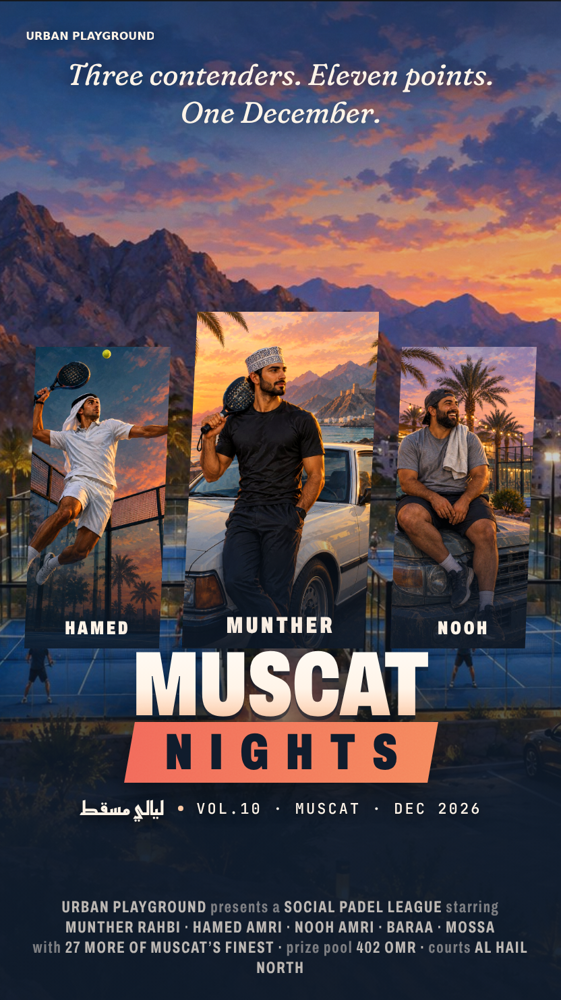

# Story · Contenders

**Reference:** `screenshots/19-story-contenders.png` · **Route:** `(share export)` · **Build phase:** 5

**Purpose:** Mid-season story of the top three.

## Layout (top to bottom)
1. Background: club art; serif tagline at top `Three contenders. Eleven points. One December.` (gap is live data).
2. Three slanted portrait panels (centre one taller) with name labels.
3. Title lockup size M, billing block.

## Data
- players ranks 1–3, gap #1–#2

## Interactions
- Export at 1080×1920

## Acceptance checklist
Tick every box in your phase report. Anything unticked must be listed with the reason.
- [ ] Tagline numbers come from data
- [ ] Matches the reference screenshot at 375px wide (layout, order, sizes, colours)
- [ ] All colours, fonts, radii come from tokens.css (no hard-coded hex values)
- [ ] No text smaller than 11px; no horizontal overflow at 360px
- [ ] All data comes from the data layer / fixtures, not hard-coded
- [ ] Every tappable element is a real <button> or <a> with a min 44px target
